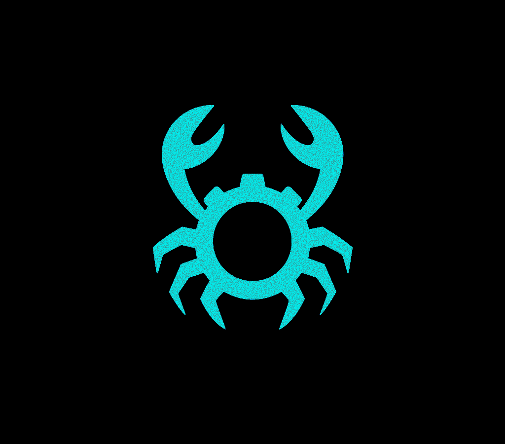

<div align="center">

# 🦀 Ferros

**A Rust-native debugger built from the same element as Rust itself.**

[](https://github.com/jamallyons/ferros)

[](https://tokei.kojix2.net/github/jamallyons/ferros)

[](./LICENSE)



**Ferros** (from *ferrum* — Latin for iron) is a next-generation debugger designed specifically for the Rust programming language.

Unlike traditional debuggers that retrofit C-style semantics onto Rust programs, Ferros is built from the ground up to understand Rust's unique memory model, lifetimes, ownership system, and mid-level intermediate representation (MIR).

</div>

---

## Mission

To give Rust developers a **first-class, language-native debugging experience** — fast, intuitive, and designed for Rust's safety guarantees.

Ferros aims to become the Rust ecosystem's standard debugging platform, complementing `cargo` and integrating cleanly with editors, IDEs, and build tools.

---

## Goals

Ferros aims to be a Rust-aware debugger: ownership, lifetimes, and MIR-level understanding, starting on macOS with Linux and Windows planned. These are goals, not current features.

---

## Current Status

Ferros is **early and experimental**. What is verified today:

- The workspace builds.
- On macOS, a binary ad-hoc signed with [`crates/ferros-macos/ferros.entitlements`](./crates/ferros-macos/ferros.entitlements) can launch a program suspended, obtain its task port, read thread and memory-region counts, resume it, and detach, without `sudo`.

Nothing else is covered by tests yet. Other code in `ferros-core` (breakpoints, stack unwinding, symbols, and so on) exists but is unverified, so it is not claimed here. The interactive TUI is being rebuilt: `ferros launch` and `attach` currently behave exactly like `--headless` (print info and exit).

The plan is tracked in epic [#26](https://github.com/JamalLyons/ferros/issues/26). See [ROADMAP.md](./ROADMAP.md) for the item list (none ticked until a test covers it).

---

## Architecture

Ferros is structured as a **workspace of multiple crates**, each with a specific responsibility:

```
ferros/
├── crates/
│   ├── ferros/          # Command-line interface
│   ├── ferros-core/     # Portable debugging engine (no OS-specific code)
│   ├── ferros-macos/    # macOS implementation (Mach APIs)
│   ├── ferros-mir/      # MIR integration & analysis
│   ├── ferros-ui/       # TUI (excluded from the workspace while being rebuilt)
│   ├── ferros-protocol/ # Communication layer
│   └── ferros-utils/    # Shared utilities & helpers
```

📖 **Learn more:** See [ARCHITECTURE.md](./docs/architecture.md) for detailed architecture documentation.

---

## Quick Start

Not published to crates.io yet. Build from source:

```bash
cargo build --workspace
cargo run -p ferros -- launch --headless <program> [args...]
```

### Requirements

- **Rust**: Edition 2024; the nightly toolchain is selected automatically by [`rust-toolchain.toml`](./rust-toolchain.toml)
- **macOS** (Apple Silicon is what CI and development use): the only supported platform today
- **Linux / Windows**: not implemented

> **Note**: On macOS, debugging other processes needs the binary to be code-signed with the debugger entitlement. Ad-hoc signing with `crates/ferros-macos/ferros.entitlements` is the verified path.

---

## Documentation

- **[Architecture](./docs/architecture.md)** — Deep dive into Ferros' design and structure
- **[Roadmap](./ROADMAP.md)** — Development milestones and planned features
- **[Contributing](./CONTRIBUTING.md)** — Guidelines for contributing to Ferros

---

## Contributing

We welcome contributions! Ferros is built with ❤️ by the Rust community.

Check out [CONTRIBUTING.md](./CONTRIBUTING.md).

---

## License

Licensed under the [Apache License](./LICENSE).

---

## Acknowledgments

Ferros draws inspiration from:
- The Rust compiler's MIR representation
- Existing debuggers like `gdb`, `lldb`, and `rr`
- Projects like `probe-rs` and `miri`

---

<div align="center">

**Ferros** — built from the same element as Rust.

[⭐ Star us on GitHub](https://github.com/jamallyons/ferros) • [📖 Read the Docs](./docs) • [🐛 Report Issues](https://github.com/jamallyons/ferros/issues)

</div>
