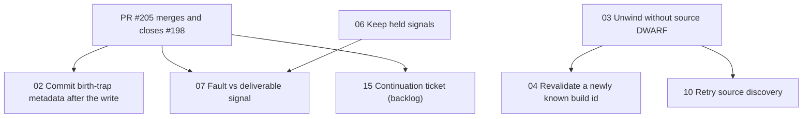

# Draft epic and child issues

File the parent below as one GitHub issue, and file each **Child** section as its own issue under that parent. The sentence under a child's title is the issue summary. An implementer has no other context: the failing-test line names the test, the setup, and the assertion that fails on trunk today and passes after the fix.

Sketches are illustrative. They show the data an implementer has to carry. They are not a signature to paste in unchanged. Types that already exist are named as they are in the crate; new names are defined next to the sketch.

## Parent issue — Make debugger results reliable across target and format boundaries

**Baseline.** Trunk [7751824](https://github.com/JamalLyons/ferros/tree/7751824b6c2f5e769900675a3f0e31913a2d2b69). [ADR 0001](https://github.com/JamalLyons/ferros/blob/7751824b6c2f5e769900675a3f0e31913a2d2b69/docs/adr/0001-object-file-boundary.md) and completed [#193](https://github.com/JamalLyons/ferros/issues/193) govern all children. Core owns portable policy, CPU operations and DWARF consumption. Each platform owns its OS and container code. No OS configuration switches, unsafe code or container parsing in core; no foreign-platform dependency in a platform adapter. Keep process control and object parsing at separate seams.

**Outcome.** A failed native write preserves both bytes and debugger bookkeeping. Stack traces use the right build, available unwind data and correct lookup addresses. Target-specific choices have explicit owners. The CLI and harness exercise the same contracts an additional adapter will need.

**Boundaries.** Build on [#196](https://github.com/JamalLyons/ferros/issues/196). [#195](https://github.com/JamalLyons/ferros/issues/195) owns agent efficiency. Preserve [#190](https://github.com/JamalLyons/ferros/issues/190) and [#191](https://github.com/JamalLyons/ferros/issues/191). Do not re-open or re-implement #193, #195, #196, or #198.

[#198](https://github.com/JamalLyons/ferros/issues/198) is still open. [PR #205](https://github.com/JamalLyons/ferros/pull/205) (`t3/issue-198`, head `e861967`, verified open on 2026-11-24) is the in-flight implementation and has not merged. It edits `crates/ferros-macos/src/task.rs`, `crates/ferros-macos/src/exception.rs`, `crates/ferros-macos/src/diagnostics.rs`, `crates/ferros-macos/src/ffi.rs`, `crates/ferros-tests/tests/lifecycle.rs`, and `crates/ferros-tests/tests/exceptions.rs` (plus that crate's manifest and `Cargo.lock`). #205 owns the fault hooks, the capped suspend retry, and the tests for these three gaps from #198:

- G1: during the detach handshake, the debugger's private SIGSTOP can sit behind a suspend the exception loop has just taken, so the handshake waits on the wrong stop.
- G3: a client SIGSTOP whose thread-update failed must not be treated as the private stop that completes a later detach handshake.
- F6: exceptions already queued on the port when it is torn down must still be answered. A failed `freeze_thread` is the same family's gap: the exception stays unanswered.

Children 02, 07, and backlogged 15 start only after #205 has merged. They edit those same files. Child 11 and child 16 also edit `task.rs`; rebase them onto the merged #205, but they do not depend on its behavior.

[#206](https://github.com/JamalLyons/ferros/issues/206) is open and separate. `lifecycle::detach_reports_a_private_stop_it_never_saw` (`crates/ferros-tests/tests/lifecycle.rs`) sometimes returns the expected detach-cleanup error and then leaves the released `loop_counter` grandchild running, with Ferros's exception port still installed. It failed on unmodified trunk `7751824` and is not caused by #205. It does not overlap an in-epic child: child 06 is about Session dropping signals before a resume starts, and child 07 is about classifying a synchronous fault. Backlogged child 15 is the nearest neighbor, and it is still a different bug (a continue whose acknowledgement timed out). Leave #206 as its own issue.

A Linux/Windows port, Phase 2, MIR and a protocol are separate product work. The UI stays parked under [#41](https://github.com/JamalLyons/ferros/issues/41).

**Parent acceptance**

- [ ] Each in-epic child merges independently after its stated prerequisites. Each behavior change has the failing test named in that child, and that test fails on the predecessor and passes after the fix. Keep existing ignored/known-broken tests and native gates.
- [ ] All listed checks pass on applicable platforms. Where a child lists `just test-integration`, run it on a signed arm64 runner and confirm `pgrep -fl ferros-fixture-` prints nothing for this worktree.
- [ ] ADR 0001 passes on trunk after every child. Existing source lookup, unwind, signal and cleanup behavior covered by earlier issues stays tested.

## Dependency graph and recommended order

Numbers on the children are stable ids, not a schedule. The arrows are the ordering that matters.



**Recommended first wave: 02, 06, 07.** These are the run-control and write-commit bugs a live session hits first.

1. Start **06** immediately. It is `ferros-core` only.
2. Start **02** once #205 has merged. It edits `task.rs`.
3. Start **07** only after both 06 and #205 are on trunk. 06 and 07 both edit `Session::resume_with_signal` in `crates/ferros-core/src/session/lifecycle.rs`. Landing 07 first means 06 has to re-apply the fault branch.

**Critical path.** **03** lands before **04** and before **10**. 04 reconciles the two metadata caches 03 introduces. 10 retries the source-debug result 03 splits out. 04 and 10 may proceed in parallel once 03 has merged.

**Any time, no shared edit with the first wave.** 01, 05, 08, 09, 12, 14, 17.

**After #205, file overlap only.** 11 and 16 also edit `task.rs`. Rebase them onto the merged #205. Their behavior does not depend on 02 or 07.

**Not in this epic.** 13 and 15 are in [Backlog / worth exploring](#backlog--worth-exploring). 15 also waits for #205.

S = one local change. M = one coordinated behavior across a few modules. L = a cross-crate interface migration with multiple adapters.

- [ ] 01 — Enforce platform ownership across workspace edges (M)
- [ ] 02 — Commit birth-trap metadata only after a successful write (M)
- [ ] 03 — Unwind an executable without source DWARF (L)
- [ ] 04 — Revalidate disk metadata when a mapped build ID becomes known (M)
- [ ] 05 — Carry each physical frame's lookup address through symbol fallback (S)
- [ ] 06 — Keep held signals until a resume actually starts their thread (M)
- [ ] 07 — Distinguish synchronous faults from deliverable signals (L)
- [ ] 08 — Let the target supply its arm64 addressing and unwind conventions (M)
- [ ] 09 — Resolve the main executable explicitly in a symbol request (M)
- [ ] 10 — Retry source discovery when its inputs change (M)
- [ ] 11 — Preserve native memory error categories at the Backend seam (M)
- [ ] 12 — Classify terminal signals at the CLI platform boundary (S)
- [ ] 14 — Give the CLI ownership of its logging worker (S)
- [ ] 16 — Release the task port taken by the debugging-permission probe (S)
- [ ] 17 — Refuse breakpoint options install cannot honor (S)

Children 13 and 15 are backlog. Their numbers stay so existing references keep pointing at the same text.

## Child 01 — Enforce platform ownership across workspace edges

The boundary check recognizes only today's macOS crate names, so a renamed or optional dependency on a future platform crate still passes, and `ferros-utils` compiles without the workspace ban on unsafe code.

**Size** M · **Dependencies** [#193](https://github.com/JamalLyons/ferros/issues/193) (closed), [#201](https://github.com/JamalLyons/ferros/issues/201) (closed). No other child.

**Why.** The accepted boundary is in place for current core sources. Both checkers name the same macOS crates and tokens by hand. The CLI scan recognizes only `ferros_macos`. Separately, `ferros-utils` defines its own lint tables without inheriting the workspace's unsafe prohibition. A green check gives no coverage of a future sibling-platform dependency or this lint omission. [adr/0001-object-file-boundary.md:61](https://github.com/JamalLyons/ferros/blob/7751824b6c2f5e769900675a3f0e31913a2d2b69/docs/adr/0001-object-file-boundary.md#L61) · [scripts/check-boundary.sh:66](https://github.com/JamalLyons/ferros/blob/7751824b6c2f5e769900675a3f0e31913a2d2b69/scripts/check-boundary.sh#L66) · [scripts/check-boundary.sh:134](https://github.com/JamalLyons/ferros/blob/7751824b6c2f5e769900675a3f0e31913a2d2b69/scripts/check-boundary.sh#L134) · [tests/platform_boundary.rs:12](https://github.com/JamalLyons/ferros/blob/7751824b6c2f5e769900675a3f0e31913a2d2b69/crates/ferros-tests/tests/platform_boundary.rs#L12) · [ferros-utils/Cargo.toml:21](https://github.com/JamalLyons/ferros/blob/7751824b6c2f5e769900675a3f0e31913a2d2b69/crates/ferros-utils/Cargo.toml#L21) · [Cargo.toml:23](https://github.com/JamalLyons/ferros/blob/7751824b6c2f5e769900675a3f0e31913a2d2b69/Cargo.toml#L23)

**Scope.** `scripts/check-boundary.sh`, `crates/ferros-tests/tests/platform_boundary.rs`, `crates/ferros-utils/Cargo.toml`. Use the existing workspace and CLI manifests as inputs. This child does not edit `ferros-macos` or the integration harness.

**Design.** Read the dependency graph from `cargo metadata --format-version 1 --no-deps` JSON. Do not pass `--filter-platform`. Use `packages[].dependencies`, not `resolve.nodes`. Each dependency object carries `name` (the package name), `rename` (present only when the manifest renames it), `optional`, `target` (the cfg string, when the edge is target-specific), and `kind`. `resolve.nodes` drops optional dependencies that are off and drops edges whose cfg does not match the host, which is exactly the edges this check has to see.

Reject a dependency from `ferros-core` to any platform crate, and a dependency from one platform crate to another, including when `optional` is true or `rename` hides the package name. Check platform names in CLI source outside the factory. Keep the existing source-marker rules (OS cfg, unsafe, Mach-O text, macOS runtime text, object-file parser crates).

One source of truth: move every predicate that the shell script and `platform_boundary.rs` currently duplicate into one Rust function. `scripts/check-boundary.sh` becomes a wrapper that runs that function (for example `cargo test -p ferros-tests --test platform_boundary -- --exact workspace_boundary`) and exits with its status. Diagnostics stay `file:line: rule: text` on stderr. The Rust test calls the same function on synthetic metadata JSON. Do not leave a second copy of the token lists in awk.

Add the rustc lint `unsafe_code = "forbid"` to `ferros-utils`. Keep its existing clippy override for `multiple_crate_versions`. Setting `lints.workspace = true` would also turn on the workspace's pedantic group, which this crate does not use today; add the rustc lint directly instead.

Add representative ELF/PE parser identifiers to the core and wrong-platform source fixtures when enforcing those ownership rules. Neutral prose naming a supported format and portable DWARF identifiers remain valid. A textual check is a guardrail, not proof of semantic portability. Keep the checker runnable in the existing Ubuntu job.

```rust
// Illustrative. The real checker can take serde_json::Value for the metadata
// document; these structs are the fields it has to read.

struct Package {
    name: String,
    dependencies: Vec<DeclaredDependency>,
}

struct DeclaredDependency {
    /// Package name (`"ferros-linux"`), never the rename.
    package: String,
    /// Set when the manifest says `os = { package = "ferros-linux" }`.
    rename: Option<String>,
    optional: bool,
    /// The `target` cfg, for example `cfg(target_os = "linux")`.
    target: Option<String>,
    kind: String,
}

struct BoundaryViolation {
    package: String,
    /// `file:line` for a real manifest. Empty for a synthetic graph.
    location: String,
    rule: String,
}

fn check_platform_edges(packages: &[Package]) -> Vec<BoundaryViolation>;
```

**Migration.** Start with synthetic dependency graphs for today's three platform names (`ferros-core`, `ferros`, `ferros-macos`) plus a fictional `ferros-linux` and `ferros-windows`. Route both existing checks through the same predicates. Preserve the shell command's nonzero status and file-level diagnostics.

**Acceptance**

- [ ] Allowed target-specific CLI and test dependencies pass. A core dependency that is optional, renamed, or cfg-gated to another OS fails. A dependency from one platform crate to another fails the same way.
- [ ] Existing core format, OS and unsafe checks still reject all their negative fixtures. Compiling `ferros-utils` enforces `unsafe_code = "forbid"`, and its clippy `multiple_crate_versions` override remains.
- [ ] Wrong-platform parser imports and signatures fail the fixtures. Simple statements that an interface can accept ELF or PE build IDs remain legal.
- [ ] Failing test: `renamed_optional_platform_dependency_is_rejected` in `crates/ferros-tests/tests/platform_boundary.rs`. Setup: synthetic cargo-metadata JSON (format-version 1) whose `packages[].dependencies` gives `ferros-core` one edge `{ "name": "ferros-linux", "rename": "os", "optional": true, "target": "cfg(target_os = \"linux\")", "kind": "normal" }`, and gives `ferros-linux` a normal dependency on package `ferros-macos`. Call the shared checker. Assert it reports a violation on `ferros-core` naming package `ferros-linux` (the rename `os` does not hide it) and a violation on the `ferros-linux` → `ferros-macos` edge. On trunk the shell script and the Rust test scan source text for the words `mach2`, `libproc`, `libc`, and `ferros-macos` only (`scripts/check-boundary.sh:66`, `platform_boundary.rs:12`). They never read cargo metadata, so this graph produces no violation and the assertion fails. After the fix the same JSON produces both violations.

**Tests to add.** Also `ferros_utils_forbids_unsafe_code` in the same file: assert `crates/ferros-utils/Cargo.toml` sets rustc `unsafe_code = "forbid"`. On trunk the `[lints]` table at line 21 sets clippy and cargo lints and has no rustc `unsafe_code` entry, so the assertion fails. Exercise the public check command on the real workspace, including the legal `ferros` → `ferros-macos` factory edge.

**Checks.** `just fmt-check`, `just lint`, `just test`, `just check-boundary`. `just test` excludes `ferros-tests`, so `just check-boundary` has to be what runs `renamed_optional_platform_dependency_is_rejected` (the shell wrapper calls that test). `just test-integration` is not required: this child does not edit `ferros-macos` or the integration harness.

## Child 02 — Commit birth-trap metadata only after a successful write

A failed write over an armed thread-start trap updates the debugger's saved instruction before the target accepts the bytes, so a later read or disarm trusts bytes the process never stored.

**Size** M · **Dependencies** [#193](https://github.com/JamalLyons/ferros/issues/193) (closed). [PR #205](https://github.com/JamalLyons/ferros/pull/205) must merge before this child starts. #205 edits `crates/ferros-macos/src/task.rs`, and so does this child.

**Why.** A write that covers an armed birth site changes its saved instruction and client-breakpoint flag before `write_target_memory` returns. An error leaves the earlier mutation visible through `mask_read` or a later disarm. The ordinary Session trap overlay already stages its changes until the backend succeeds. The existing injected failure fires before the faulty ordering. [src/birth.rs:206](https://github.com/JamalLyons/ferros/blob/7751824b6c2f5e769900675a3f0e31913a2d2b69/crates/ferros-macos/src/birth.rs#L206) · [src/task.rs:2214](https://github.com/JamalLyons/ferros/blob/7751824b6c2f5e769900675a3f0e31913a2d2b69/crates/ferros-macos/src/task.rs#L2214) · [src/birth.rs:192](https://github.com/JamalLyons/ferros/blob/7751824b6c2f5e769900675a3f0e31913a2d2b69/crates/ferros-macos/src/birth.rs#L192) · [src/birth.rs:468](https://github.com/JamalLyons/ferros/blob/7751824b6c2f5e769900675a3f0e31913a2d2b69/crates/ferros-macos/src/birth.rs#L468) · [session/breakpoints.rs:408](https://github.com/JamalLyons/ferros/blob/7751824b6c2f5e769900675a3f0e31913a2d2b69/crates/ferros-core/src/session/breakpoints.rs#L408) · [tests/code_writes.rs:150](https://github.com/JamalLyons/ferros/blob/7751824b6c2f5e769900675a3f0e31913a2d2b69/crates/ferros-tests/tests/code_writes.rs#L150)

**Scope.** `BirthPolicy`, `BirthSite`, `MacOSBackend::write_memory` and `write_target_memory` in `ferros-macos/src/{birth,task}.rs`. Existing tests in `ferros-tests/tests/code_writes.rs`.

**Design.** Prepare the bytes to write and the exact per-site updates without side effects. Apply those updates under the stopped target's serialization after the fallible memory write succeeds. Preserve internal traps on partial overlaps and cache invalidation on both outcomes.

```rust
// Illustrative. Private to ferros-macos. `Address` already exists in ferros-core.
// A birth site's saved instruction is a 4-byte arm64 word.

struct BirthSiteUpdate {
    address: u64,
    original: [u8; 4],
    /// True when the word is the debugger's own trap, planted for a client breakpoint.
    client_breakpoint: bool,
}

struct BirthWrite {
    address: Address,
    /// Bytes to store. Armed traps stay in the target's memory.
    bytes: Vec<u8>,
    sites: Vec<BirthSiteUpdate>,
}

fn plan_engine_write(&self, at: Address, bytes: &[u8]) -> Option<BirthWrite>;
fn commit_engine_write(&mut self, write: BirthWrite);
```

**Migration.** Start with a failed physical write following preparation. Move mutation into the commit operation. Audit detach/disarm and the shared-state lock so a pending exception cannot invalidate a prepared update. The existing `fail_memory_write` flag returns at `task.rs:2214`, before `birth_engine_write`. The new test needs a failure that happens inside `write_target_memory` after planning.

**Acceptance**

- [ ] A refused write leaves the logical bytes, saved originals and ownership of all covered birth sites unchanged.
- [ ] A successful partial write updates only its covered bytes. A client trap remains observable and disarm restores the last successful original.
- [ ] Failing test: `failed_overlapping_birth_write_keeps_the_saved_instruction` in `crates/ferros-tests/tests/code_writes.rs`, inside `harness::run`. Setup: arm a birth entry trap, remember the instruction `mask_read` returns and the site's client-breakpoint flag, then write bytes that overlap that site while the physical store fails after planning. Assert `mask_read` still returns the saved instruction and the client-breakpoint flag is unchanged. On trunk `BirthPolicy::filter_engine_write` (`birth.rs:206`) assigns `site.original` and `site.client_breakpoint` before `write_target_memory` returns, so after the error `mask_read` (`birth.rs:192`) shows the new bytes and the assertion fails. After the fix the metadata changes only once the store has succeeded. The existing test `refused_write_across_a_code_region_end_leaves_memory_unchanged` (`code_writes.rs:150`) stays; it injects the failure before this ordering and does not cover it.

**Tests to add.** After the failing write, retry the same bytes successfully and then disarm. Assert disarm restores the instruction from the successful write. Keep the existing cross-region rollback and birth masking tests.

**Checks.** `just fmt-check`, `just lint`, `just test`, `just check-boundary`, and on a signed macOS arm64 runner `just test-integration`. Then `pgrep -fl ferros-fixture-` prints nothing for this worktree.

## Child 03 — Unwind an executable without source DWARF

When an executable has unwind tables but no separate debug file, the debugger drops the whole image, so a stack trace and step-out cannot see a caller that only those tables describe.

**Size** L · **Dependencies** [#193](https://github.com/JamalLyons/ferros/issues/193) (closed). This child is the critical path for 04 and 10. Both wait until it has merged.

**Why.** Mach-O loads the executable mapping, then requires debug discovery before returning executable unwind tables. A missing companion keeps the image out of `SymbolCache`. With no image the unwinder can only try its frame-pointer path. `finish` uses that same caller. The existing no-DWARF test requests one frame, while the CFI tests enter below Session. [macho/image.rs:396](https://github.com/JamalLyons/ferros/blob/7751824b6c2f5e769900675a3f0e31913a2d2b69/crates/ferros-macos/src/macho/image.rs#L396) · [macho/image.rs:416](https://github.com/JamalLyons/ferros/blob/7751824b6c2f5e769900675a3f0e31913a2d2b69/crates/ferros-macos/src/macho/image.rs#L416) · [session/images.rs:356](https://github.com/JamalLyons/ferros/blob/7751824b6c2f5e769900675a3f0e31913a2d2b69/crates/ferros-core/src/session/images.rs#L356) · [symbols/unwind.rs:379](https://github.com/JamalLyons/ferros/blob/7751824b6c2f5e769900675a3f0e31913a2d2b69/crates/ferros-core/src/symbols/unwind.rs#L379) · [session/line_stepping.rs:144](https://github.com/JamalLyons/ferros/blob/7751824b6c2f5e769900675a3f0e31913a2d2b69/crates/ferros-core/src/session/line_stepping.rs#L144) · [tests/debuginfo.rs:291](https://github.com/JamalLyons/ferros/blob/7751824b6c2f5e769900675a3f0e31913a2d2b69/crates/ferros-tests/tests/debuginfo.rs#L291) · [tests/unwind_eh_frame.rs:210](https://github.com/JamalLyons/ferros/blob/7751824b6c2f5e769900675a3f0e31913a2d2b69/crates/ferros-tests/tests/unwind_eh_frame.rs#L210)

**Scope.** `objfile::{ImageContents,ObjectFormat}`, `symbols::{BinaryImage,SymbolCache}`, `session::{images,stack}`, `MockObjectFormat`, `ferros-macos/src/macho/{image,debuginfo,mod}.rs`.

**Design.** Keep validated executable metadata independently of optional source DWARF. File identity and slide constrain both. Executable CFI and unwind hints remain usable when source lookup fails. Keep companion-provided `.debug_frame` with source metadata and executable `.eh_frame` with the executable. Preserve the typed error for direct source-symbol requests and the public `SymbolCache::load_image` compatibility path.

`ImageMapping`, `SectionData`, `Architecture`, `RunTimeEndian`, `UnwindHints`, `SectionId`, and `LoadedImage` already exist. `ImageRequest` and `DebugSections` are new names for this split.

```rust
// Illustrative. The adapter can keep these private and still return `ImageContents`
// to existing callers once both halves have been filled or have failed on their own.

struct ImageRequest {
    image: LoadedImage,
}

struct ExecutableMetadata {
    mapping: ImageMapping,
    architecture: Architecture,
    endian: RunTimeEndian,
    eh_frame: Option<SectionData>,
    eh_frame_hdr: Option<SectionData>,
    unwind_hints: Option<Box<dyn UnwindHints>>,
}

/// Companion DWARF only. `.debug_frame` stays here. `.eh_frame` stays on the executable.
struct DebugSections {
    dwarf: HashMap<SectionId, Arc<[u8]>>,
    debug_frame: Option<SectionData>,
}

fn open_executable(&self, image: &ImageRequest) -> Result<ExecutableMetadata>;
fn source_debug(&self, image: &ImageRequest) -> Result<DebugSections>;
```

**Migration.** First add a Session test whose caller cannot be found by the frame pointer or the link register. Split the adapter's discovery step, cache the two outcomes independently, then route stack walking and symbolication to the appropriate outcome. Keep section buffers shared.

**Acceptance**

- [ ] A mapped file with usable executable CFI and no companion yields the expected caller through `Session::stack_trace`. `Session::symbolicate` on that address still reports `NoDebugInfo`.
- [ ] Existing hinted, inline, frame-pointer and external-debug behavior survives. No placeholder DWARF is necessary for unwind-only input.
- [ ] Failing test: `stripped_executable_still_unwinds_its_caller` in `crates/ferros-tests/tests/debuginfo.rs`, inside `harness::run`. Setup: a fixture whose executable still has `.eh_frame` (or compact-unwind hints that point at it) and whose companion debug file is absent. Stop in a frameless function, with frame pointer 0 and a link register that does not point at the real caller. Call `Session::stack_trace`. Assert the caller frame is present and its PC is the return address recorded in that executable unwind info. On trunk `macho/image.rs:396` runs debug discovery before it will return `ImageContents`, a missing companion stores `NoDebugInfo` and leaves the image out of `SymbolCache`, and `StackUnwinder::step` (`symbols/unwind.rs:379`) then has only the frame-pointer path. The caller frame is absent, so the assertion fails. After the fix the executable unwind data is cached even though symbolication still returns `NoDebugInfo`. The existing no-DWARF test (`debuginfo.rs:291`) asks for one frame, and the CFI tests (`unwind_eh_frame.rs:210`) call the unwinder below Session, so neither is this test.

**Tests to add.** Add a portable Session case in `unwind_eh_frame.rs` with frame pointer 0, a misleading link register, and `.eh_frame` present with an empty DWARF map, so the core routing stays covered without a Mach-O file. Where a caller is recoverable, `finish` stops in that caller.

**Checks.** `just fmt-check`, `just lint`, `just test`, `just check-boundary`, and on a signed macOS arm64 runner `just test-integration`. Then `pgrep -fl ferros-fixture-` prints nothing for this worktree.

## Child 04 — Revalidate disk metadata when a mapped build ID becomes known

The debugger can keep serving symbols and unwind data from a file it opened while the build id was unknown, even after the loader reports a different build id for that mapping.

**Size** M · **Dependencies** [#193](https://github.com/JamalLyons/ferros/issues/193) (closed), child 03 (the executable metadata and the source metadata are cached separately).

**Why.** An unknown UUID allows a disk slice to be accepted without identity verification. A later known loader ID updates the Session image and selector, but keeps the old symbol handle. The next load returns early. If the open file belonged to another build, it can continue supplying names, lines and CFI. [macho/image.rs:276](https://github.com/JamalLyons/ferros/blob/7751824b6c2f5e769900675a3f0e31913a2d2b69/crates/ferros-macos/src/macho/image.rs#L276) · [macho/image.rs:314](https://github.com/JamalLyons/ferros/blob/7751824b6c2f5e769900675a3f0e31913a2d2b69/crates/ferros-macos/src/macho/image.rs#L314) · [session/images.rs:261](https://github.com/JamalLyons/ferros/blob/7751824b6c2f5e769900675a3f0e31913a2d2b69/crates/ferros-core/src/session/images.rs#L261) · [session/images.rs:340](https://github.com/JamalLyons/ferros/blob/7751824b6c2f5e769900675a3f0e31913a2d2b69/crates/ferros-core/src/session/images.rs#L340) · [tests/backend_mock.rs:2998](https://github.com/JamalLyons/ferros/blob/7751824b6c2f5e769900675a3f0e31913a2d2b69/crates/ferros-tests/tests/backend_mock.rs#L2998) · [tests/debuginfo.rs:464](https://github.com/JamalLyons/ferros/blob/7751824b6c2f5e769900675a3f0e31913a2d2b69/crates/ferros-tests/tests/debuginfo.rs#L464)

**Scope.** `SessionImage`, `SymbolCache`, `ImageContents` and the executable metadata from child 03, `MachOFormat` and `MockObjectFormat`. `session/images.rs`, `symbols/{cache,image}.rs`, `objfile/{contents,mock}.rs`, `macho/image.rs`.

**Design.** Attach the build identity observed in the opened file to disk-derived metadata. On new positive evidence, retain verified matches. Evict contrary or unverified entries and reload through the validated selector. Keep still-valid target mappings, and keep mapped-memory symbol tables separate from disk data.

`BuildIdentity` and `ImageSlice` already exist.

```rust
// Illustrative. `observed` is the id read from the file, which can disagree
// with the id the loader reported for the mapping.

struct OpenedBuild {
    observed: BuildIdentity,
    slice: Option<ImageSlice>,
}

fn reconcile_disk_build(&mut self, mapped: BuildIdentity);
```

**Migration.** Drive unknown-to-known through a successful unverified open. Record the file's observed identity in the adapter. Reconcile before the cached-success shortcut and prune by the actual cache handle.

**Acceptance**

- [ ] Wrong-build DWARF and unwind bytes are inaccessible after a contradictory known ID arrives. A file whose observed id matches can still serve queries.
- [ ] Mapping retention on unknown-to-known, known-to-unknown tolerance, and `Absent` reuse only within one stop retain their existing coverage. A failed or missing slice cannot bypass verification.
- [ ] Failing test: `contradictory_build_id_stops_serving_the_old_file` in `crates/ferros-tests/tests/backend_mock.rs`. Setup: the first image refresh reports `BuildIdentity::Unknown` at a path and load address, and the object format opens a file whose observed id is build A and whose symbol at the PC is `from_a`. The second refresh reports the same path and load address with build id B, different from A. The format counts opens. Assert that after the second refresh the symbol name at that PC is not `from_a`, and that the format was asked to open again. On trunk `load_images` (`session/images.rs:261`) keeps the old `SessionImage`, including its symbol handle, and only folds the new id in with `or_later`. `load_symbols_for_address` (`session/images.rs:340`) returns immediately when `symbols` is already set, so the name is still `from_a` and the assertion fails. After the fix the unverified handle is dropped and the matching file is opened.

**Tests to add.** Add a `debuginfo.rs` case with a mismatched thin file followed by a known mapped id. Exercise both stack and symbol lookup after refresh. Keep the test at `backend_mock.rs:2998` and `debuginfo.rs:464`.

**Checks.** `just fmt-check`, `just lint`, `just test`, `just check-boundary`, and on a signed macOS arm64 runner `just test-integration`. Then `pgrep -fl ferros-fixture-` prints nothing for this worktree.

## Child 05 — Carry each physical frame's lookup address through symbol fallback

A signal that lands on the first instruction of a function is displayed as the previous function, because the name lookup walks back four bytes instead of using the address the unwinder already chose.

**Size** S · **Dependencies** [#193](https://github.com/JamalLyons/ferros/issues/193) (closed). No other child.

**Why.** The unwind cursor distinguishes a return address from the exact interrupted PC. Session discards that distinction and subtracts four from every unnamed non-top frame. A signal interrupt at a function entry can therefore be displayed as the preceding function. Lazy image loading also probes PC minus four for every frame. [symbols/unwind.rs:349](https://github.com/JamalLyons/ferros/blob/7751824b6c2f5e769900675a3f0e31913a2d2b69/crates/ferros-core/src/symbols/unwind.rs#L349) · [symbols/unwind.rs:364](https://github.com/JamalLyons/ferros/blob/7751824b6c2f5e769900675a3f0e31913a2d2b69/crates/ferros-core/src/symbols/unwind.rs#L364) · [session/stack.rs:135](https://github.com/JamalLyons/ferros/blob/7751824b6c2f5e769900675a3f0e31913a2d2b69/crates/ferros-core/src/session/stack.rs#L135) · [session/stack.rs:159](https://github.com/JamalLyons/ferros/blob/7751824b6c2f5e769900675a3f0e31913a2d2b69/crates/ferros-core/src/session/stack.rs#L159) · [tests/backend_mock.rs:3165](https://github.com/JamalLyons/ferros/blob/7751824b6c2f5e769900675a3f0e31913a2d2b69/crates/ferros-tests/tests/backend_mock.rs#L3165)

**Scope.** `StackUnwinder`, `append_logical_frames`, `Session::stack_trace` and `name_frames_from_symbol_tables` in `symbols/unwind.rs` and `session/stack.rs`. Keep public `StackFrame` and `FrameId` semantics. This child does not edit `ferros-macos` or the integration harness.

**Design.** Compute the lookup address once at the cursor. Propagate it with each logical frame for lazy image loading, DWARF and symbol-table naming. Keep raw PC, frame index and return address available to callers.

`StackFrame`, `Address`, `ThreadId`, and `Registers` already exist.

```rust
// Illustrative. Private to the unwind and stack modules.
// `lookup` is the address `StackUnwinder::lookup_address` already computes:
// the PC itself for an interrupted frame, the call instruction for a caller.

struct LocatedFrame {
    frame: StackFrame,
    lookup: Address,
}

fn unwind_located(
    &self,
    thread: ThreadId,
    regs: &Registers,
    limit: usize,
) -> Result<Vec<LocatedFrame>>;
```

**Migration.** First extend the existing synthetic signal-stack test with two adjacent named functions. Add the private located-frame result, then have the existing public unwind API project its frames.

**Acceptance**

- [ ] A non-top interrupted frame on a symbol boundary names the interrupted instruction's function.
- [ ] A regular caller at an image boundary still resolves at its call site. Inline expansion and the public raw PC remain stable.
- [ ] Failing test: `signal_at_function_entry_is_not_named_as_the_previous_function` in `crates/ferros-tests/tests/backend_mock.rs`, beside the signal-stack test at line 3165. Setup: `MockRuntime` marks the frame as a signal interrupt. The mapped symbol table has `previous` ending at `pc - 4` and `entry` starting at `pc`. Drive `Session::stack_trace`. Assert the interrupted frame's symbol name is `entry`. On trunk `name_frames_from_symbol_tables` (`session/stack.rs:159`) subtracts 4 from every frame whose index is not 0, and ignores `lookup_address` (`symbols/unwind.rs:364`), which keeps the raw PC when the frame is not a caller. The name comes back as `previous`, so the assertion fails. After the fix the naming pass uses the lookup address the cursor already chose.

**Tests to add.** Keep the regular-caller image-boundary case and the existing signal backtrace at `backend_mock.rs:3165`, which checks PCs. Do not weaken `tests/signal_tracing.rs`; this child does not need to run it to land.

**Checks.** `just fmt-check`, `just lint`, `just test`, `just check-boundary`, plus `cargo test -p ferros-tests --test backend_mock signal_at_function_entry_is_not_named_as_the_previous_function`. That file is the portable mock suite: it does not launch a fixture and does not need a signed runner. `just test` excludes `ferros-tests`, and the full `just test-integration` is not required, because this child does not edit `ferros-macos` or the integration harness.

## Child 06 — Keep held signals until a resume actually starts their thread

A resume that fails before any thread runs throws away signals the debugger was still supposed to deliver, so the next successful continue never passes them on.

**Size** M · **Dependencies** [#193](https://github.com/JamalLyons/ferros/issues/193) (closed). Must merge before child 07. Both edit `Session::resume_with_signal` in `crates/ferros-core/src/session/lifecycle.rs`. This child does not wait on #205.

**Why.** `resume_with_signal` takes the carried list before the stopped-state check and before draining can fail. `resume()` also clears the list before validation. `resume_request` restores signals on one deferred-event path. An ordinary failure before backend resume or an invalid call while a stop is deferred can consume previously held intent. The handler path already removes signals only after a successful start. [session/lifecycle.rs:165](https://github.com/JamalLyons/ferros/blob/7751824b6c2f5e769900675a3f0e31913a2d2b69/crates/ferros-core/src/session/lifecycle.rs#L165) · [session/lifecycle.rs:198](https://github.com/JamalLyons/ferros/blob/7751824b6c2f5e769900675a3f0e31913a2d2b69/crates/ferros-core/src/session/lifecycle.rs#L198) · [session/lifecycle.rs:208](https://github.com/JamalLyons/ferros/blob/7751824b6c2f5e769900675a3f0e31913a2d2b69/crates/ferros-core/src/session/lifecycle.rs#L208) · [session/stepping.rs:208](https://github.com/JamalLyons/ferros/blob/7751824b6c2f5e769900675a3f0e31913a2d2b69/crates/ferros-core/src/session/stepping.rs#L208) · [session/stepping.rs:232](https://github.com/JamalLyons/ferros/blob/7751824b6c2f5e769900675a3f0e31913a2d2b69/crates/ferros-core/src/session/stepping.rs#L232) · [backend/types.rs:314](https://github.com/JamalLyons/ferros/blob/7751824b6c2f5e769900675a3f0e31913a2d2b69/crates/ferros-core/src/backend/types.rs#L314) Source stepping also drops the selected thread's signal before even reading registers. Instruction stepping already waits for a successful start. [session/line_stepping.rs:130](https://github.com/JamalLyons/ferros/blob/7751824b6c2f5e769900675a3f0e31913a2d2b69/crates/ferros-core/src/session/line_stepping.rs#L130) · [session/stepping.rs:498](https://github.com/JamalLyons/ferros/blob/7751824b6c2f5e769900675a3f0e31913a2d2b69/crates/ferros-core/src/session/stepping.rs#L498)

**Scope.** `Session::{resume,resume_with_signal,resume_request}`, `carried_signals`, and the existing start/refusal helpers in `session/{lifecycle,stepping,line_stepping}.rs`. Keep `StopEvent` delivery and the backend state machine. This child does not edit `ferros-macos` or the integration harness.

**Design.** Validate state first. Prepare the requested deliveries without consuming held state. Commit only for threads actually allowed to run. Apply an explicit drop of a signal at the same moment that drop becomes a completed decision (a plain `resume`, or a source step that has successfully started). Distinguish successful starts, queued stops, delayed terminal events and failures. Reuse the existing refusal and stale-event filtering logic.

`ResumeRequest` and `ThreadId` already exist.

```rust
// Illustrative. Private to session::lifecycle.

enum SignalPolicy {
    /// `resume_with_signal`: deliver what is still held.
    Forward,
    /// `resume`: drop what is still held, once the call is valid.
    Suppress,
}

struct PendingSignals {
    deliveries: Vec<(ThreadId, i32)>,
}

fn prepare_signals(&self, policy: SignalPolicy) -> PendingSignals;
fn commit_started(&mut self, started: &ResumeRequest);
```

**Migration.** First reproduce two distinct held signals plus a failed pre-start drain. Move signal ownership into one private helper and migrate plain, forwarding and handler continues plus source-step suppression. Check partial step-over success separately so a signal is not delivered twice.

**Acceptance**

- [ ] An invalid second resume and an injected pre-start failure preserve every still-held signal for the next valid forwarding resume.
- [ ] A successfully started thread receives its signal exactly once. Suspended peers retain theirs. Explicit suppression, zero-timeout wait and terminal cleanup continue to work.
- [ ] Failing test: `pre_start_failure_still_delivers_both_held_signals` in `crates/ferros-tests/tests/backend_mock.rs`. Setup: `MockBackend::script_simultaneous` with two threads. Thread 1 is stopped on signal 5 and thread 2 on signal 6. `fail_next(Wait, ...)` makes the drain before `Backend::resume` fail. Call `resume_with_signal`, observe the error, then call `resume_with_signal` again with no new stop. Assert the recorded `MockCall::Resume` carries exactly `(thread 1, 5)` and `(thread 2, 6)`, each once. On trunk `resume_with_signal` (`lifecycle.rs:198`) takes `carried_signals` before `resume_request` reaches `require_stopped` (`lifecycle.rs:208`), and `resume` (`lifecycle.rs:165`) clears the list even earlier. The failed call drops the request, the second resume's signal list is empty, and the assertion fails. After the fix the signals stay held until a resume actually starts.

**Tests to add.** Add `source_step_register_failure_still_delivers_the_signal` in the same file: a source step whose `read_registers` fails (`line_stepping.rs:130` currently drops that thread's signal first), then a forwarding continue. Assert the signal is on the successful `MockCall::Resume`. On trunk the signal is already gone, so the assertion fails. Also retry after an invalid resume during a deferred stop. Keep the native signal-tracing tests as they are; this child does not need to run them to land.

**Checks.** `just fmt-check`, `just lint`, `just test`, `just check-boundary`, plus `cargo test -p ferros-tests --test backend_mock pre_start_failure_still_delivers_both_held_signals`. That file is the portable mock suite: it does not launch a fixture and does not need a signed runner. `just test` excludes `ferros-tests`, and the full `just test-integration` is not required, because this child does not edit `ferros-macos` or the integration harness.

## Child 07 — Distinguish synchronous faults from deliverable signals

A crash such as a bad memory access is reported as an ordinary signal, and continuing asks macOS to deliver a signal the kernel adapter never held, so the continue is rejected.

**Size** L · **Dependencies** Child 06 merged (both edit `resume_with_signal` in `session/lifecycle.rs`). [PR #205](https://github.com/JamalLyons/ferros/pull/205) must merge before this child starts: it edits `exception.rs`, `task.rs`, `tests/exceptions.rs`, and `tests/lifecycle.rs`, and this child edits those same files. [#193](https://github.com/JamalLyons/ferros/issues/193) is closed. Child 06 owns how long a queued signal lives. This child owns which stops are signals.

**Why.** An access violation and a held soft signal can both surface as `StopEvent::Signal`. Session consequently builds a signal-delivery request for either. macOS retains forwarding eligibility only for soft signals and rejects the fault request. The mismatch follows directly from the decoder, held-stop bookkeeping and validator. [src/exception.rs:998](https://github.com/JamalLyons/ferros/blob/7751824b6c2f5e769900675a3f0e31913a2d2b69/crates/ferros-macos/src/exception.rs#L998) · [src/exception.rs:1518](https://github.com/JamalLyons/ferros/blob/7751824b6c2f5e769900675a3f0e31913a2d2b69/crates/ferros-macos/src/exception.rs#L1518) · [src/exception.rs:2093](https://github.com/JamalLyons/ferros/blob/7751824b6c2f5e769900675a3f0e31913a2d2b69/crates/ferros-macos/src/exception.rs#L2093) · [src/task.rs:1643](https://github.com/JamalLyons/ferros/blob/7751824b6c2f5e769900675a3f0e31913a2d2b69/crates/ferros-macos/src/task.rs#L1643) · [session/lifecycle.rs:198](https://github.com/JamalLyons/ferros/blob/7751824b6c2f5e769900675a3f0e31913a2d2b69/crates/ferros-core/src/session/lifecycle.rs#L198) · [src/exception.rs:2586](https://github.com/JamalLyons/ferros/blob/7751824b6c2f5e769900675a3f0e31913a2d2b69/crates/ferros-macos/src/exception.rs#L2586)

**Scope.** This is a public enum change. Every crate that matches `StopEvent` exhaustively has to compile again:

- `ferros-core`: the enum and `thread()` in `backend/types.rs`; `Session::resume_with_signal` and the other session matches in `session/{mod,lifecycle,breakpoints,stepping,line_stepping,exits}.rs`; `session/tests.rs` and `session/tests/stepping.rs`; `arch/mod.rs`; `backend/mock.rs` (scripted stops and the recorded resume). `MockBackend` lives in this crate.
- `ferros-macos`: `exception.rs` (`stop_event_from_exception`, and the soft-signal list that today ignores a fault), `task.rs` (`check_resume_request`), and the other matches in `lib.rs`, `lifecycle.rs`, `birth.rs`, and `registers/debug.rs`.
- `ferros` (the CLI): `repl/mod.rs`, `repl/output.rs`, `repl/tests.rs`.
- `ferros-tests`: every test that matches `StopEvent`, including `exceptions.rs`, `backend_mock.rs`, `signal_tracing.rs`, `lifecycle.rs`, `single_step.rs`, `breakpoints.rs`, `stepping.rs`, `source_breakpoints.rs`, `backtrace.rs`, `code_writes.rs`, `debuginfo.rs`, `exit_watcher.rs`, `images.rs`, and `non_local_exits.rs`.

`ferros-utils` does not match `StopEvent`. The parked `ferros-ui` uses `DebuggerEvent`, not `StopEvent`; leave it alone. Preserve the backend's existing validation for real soft signals.

**Design.** Introduce a typed fault stop carrying its thread and a portable category. Translate native reasons in the macOS adapter. Keep the raw text for diagnostics. Reserve `Signal` for stops that have a pending signal decision. After a fault, `resume_with_signal` continues that thread without a signal entry. Signals still held for other threads stay in the request. A persistent fault may stop again at the same PC.

`ThreadId` already exists. `FaultKind` is new and lives in `ferros-core`, next to `StopEvent`. It must not carry a Mach exception type or a POSIX signal number.

```rust
// Real variant to add. `detail` is for logs. Callers match on `kind`.

enum FaultKind {
    /// `EXC_BAD_ACCESS` on macOS. Not a held SIGSEGV.
    MemoryAccess,
    /// `EXC_BAD_INSTRUCTION` on macOS. Not a held SIGILL.
    IllegalInstruction,
    /// `EXC_ARITHMETIC` on macOS. Not a held SIGFPE.
    Arithmetic,
    /// A synchronous fault the adapter does not classify further.
    Other,
}

enum StopEvent {
    // ...existing variants...
    Fault {
        thread: ThreadId,
        kind: FaultKind,
        detail: String,
    },
}

impl StopEvent {
    /// `Some` only for `StopEvent::Signal`. A `Fault` returns `None`.
    fn deliverable_signal(&self) -> Option<(ThreadId, i32)>;
}
```

**Migration.** Pin fault and soft-signal behavior in one public Session test before changing the enum. Update exhaustive consumers, CLI display and mock scripts in the same change. Leave native exception reply timing with its current owner (#205 once merged). Do not encode the fault as a POSIX signal so that a future Windows adapter can report the same `FaultKind`.

**Acceptance**

- [ ] A fault can be identified and formatted without consulting its diagnostic text. A forwarding continue after a fault emits no signal request for that fault.
- [ ] Genuine soft signals still support suppression and forwarding, including a separately held signal on a peer. A repeated synchronous fault remains observable.
- [ ] Native reason translation stays in `ferros-macos`. Session and the CLI handle the new variant exhaustively.
- [ ] Failing test: `access_fault_continue_is_not_rejected_as_a_signal` in `crates/ferros-tests/tests/exceptions.rs`, inside `harness::run`. Setup: launch a small fixture that stores through a null pointer, and `wait` until it stops. Call `Session::resume_with_signal`. Assert the call returns `Ok(())`, and the next stop is the same fault at the same PC (the instruction is retried). On trunk `stop_event_from_exception` maps `EXC_BAD_ACCESS` to `StopEvent::Signal { signal: SIGSEGV }` (`exception.rs:998`, asserted at `exception.rs:2586`). The fault is not recorded as a soft signal (`exception.rs:1518`). `resume_with_signal` (`lifecycle.rs:198`) puts SIGSEGV on the resume, and `check_resume_request` (`task.rs:1643`) returns `Unsupported("signal injection requires a held soft-signal exception")`. The `Ok(())` assertion fails. After the fix the stop is `Fault { kind: MemoryAccess, .. }`, the resume carries no signal for that thread, and the fault stops the process again.

**Tests to add.** Update `other_exceptions_keep_their_mapping` in `exception.rs` so `EXC_BAD_ACCESS`, `EXC_BAD_INSTRUCTION`, and `EXC_ARITHMETIC` expect `Fault` with `MemoryAccess`, `IllegalInstruction`, and `Arithmetic`. A soft `EXC_SOFT_SIGNAL` stays `StopEvent::Signal`. In `backend_mock.rs`, script a `Fault` on one thread and a held signal on a peer, call `resume_with_signal`, and assert the recorded `MockCall::Resume` contains only the peer signal. Deliver one real soft signal in the macOS suite and assert its handler runs once. Extend CLI stop formatting so a fault prints its kind and does not take the signal-forwarding branch.

**Checks.** `just fmt-check`, `just lint`, `just test`, `just check-boundary`, and on a signed macOS arm64 runner `just test-integration`. Then `pgrep -fl ferros-fixture-` prints nothing for this worktree.

## Child 08 — Let the target supply its arm64 addressing and unwind conventions

Breakpoint addresses and stack unwinding always use Apple's 47-bit pointer mask and Apple's "undefined return address means the link register" rule, even when the target asked for a different address width or return rule.

**Size** M · **Dependencies** [#193](https://github.com/JamalLyons/ferros/issues/193) (closed). No other child.

**Why.** A platform can construct `Arm64::with_addressable_bits` but cannot get that instance into Session's normal breakpoint or stack paths. One trap normalization call even bypasses `Session::arch`. The undefined-return-column CFI fallback also assumes the Apple CIE convention. An arm64 port would inherit both decisions before adding any CPU instructions. [arch/arm64.rs:15](https://github.com/JamalLyons/ferros/blob/7751824b6c2f5e769900675a3f0e31913a2d2b69/crates/ferros-core/src/arch/arm64.rs#L15) · [arch/mod.rs:195](https://github.com/JamalLyons/ferros/blob/7751824b6c2f5e769900675a3f0e31913a2d2b69/crates/ferros-core/src/arch/mod.rs#L195) · [session/breakpoints.rs:117](https://github.com/JamalLyons/ferros/blob/7751824b6c2f5e769900675a3f0e31913a2d2b69/crates/ferros-core/src/session/breakpoints.rs#L117) · [session/lifecycle.rs:404](https://github.com/JamalLyons/ferros/blob/7751824b6c2f5e769900675a3f0e31913a2d2b69/crates/ferros-core/src/session/lifecycle.rs#L404) · [symbols/unwind.rs:625](https://github.com/JamalLyons/ferros/blob/7751824b6c2f5e769900675a3f0e31913a2d2b69/crates/ferros-core/src/symbols/unwind.rs#L625) · [src/lib.rs:236](https://github.com/JamalLyons/ferros/blob/7751824b6c2f5e769900675a3f0e31913a2d2b69/crates/ferros-macos/src/lib.rs#L236)

**Scope.** `Arch`, `Arm64`, `Session::arch`, stop normalization, `StackUnwinder::recover`, `MacOSBackend`, `MockBackend` and platform assembly. Keep target-specific choices in platform code. `ferros-core` gains no `cfg(target_os)` and no OS type.

**Design.** Select target facts from the attached or launched process via the backend or the platform factory. Use one owned or shared `Arch` for the duration of an operation. The macOS adapter configures pointer width and the undefined-return rule explicitly. Use one resolver for all callers, including the trap normalization that today bypasses `Session::arch`. Preserve unsupported-architecture errors and the host architecture reported before launch.

`Arch` and `BackendResult` already exist. `UndefinedReturnAddress` is new and lives on the `Arch` value, in `ferros-core`.

```rust
// Illustrative. Both methods are on the Arch the backend returns for this process.
// `target_arch` may live on Backend; the return rule lives on Arch.

enum UndefinedReturnAddress {
    /// Apple's CIE: an undefined return column is the link register.
    LinkRegister,
    /// The trace ends when the return column is undefined.
    EndTrace,
}

fn target_arch(&self) -> BackendResult<Arc<dyn Arch>>;
fn undefined_return_address(&self) -> UndefinedReturnAddress;
```

**Migration.** Secure the present raw and normalized PC behavior with an injected architecture test. Route both lookups through it. Test a second address width and a strict undefined-return policy with neutral input before deleting the implicit platform choices. macOS keeps 47-bit addresses and `LinkRegister`.

**Acceptance**

- [ ] A Session backtrace can retain a valid address bit above 47 on a mock target configured for 64 significant bits, and macOS preserves its current address normalization.
- [ ] An explicitly undefined CFI return rule can end a trace on a strict target. The configured macOS case still unwinds its saved or live link register.
- [ ] Failing test: `configured_address_width_keeps_bit_48_in_a_session_backtrace` in `crates/ferros-tests/tests/backend_mock.rs`. Setup: a mock whose `target_arch` is `Arm64::with_addressable_bits(64)`, and a caller return address with bit 48 set. Call `Session::stack_trace`. Assert that bit is still set on the caller's PC. On trunk `Session::arch` (`session/breakpoints.rs:117`) uses `arch::for_architecture`, which builds `Arm64::new` with 47 significant bits (`arch/arm64.rs:15`). `strip_pointer_auth` clears bit 48, so the assertion fails. After the fix the session uses the arch the backend returned and the bit survives. Reverting the session to `for_architecture` makes the assertion fail again.

**Tests to add.** A second portable case where the return column is undefined and the policy is `EndTrace`: the trace stops, it does not invent a caller from the link register. Keep `for_architecture`'s unsupported x86-64 test and the native prologue and epilogue cases.

**Checks.** `just fmt-check`, `just lint`, `just test`, `just check-boundary`, and on a signed macOS arm64 runner `just test-integration`. Then `pgrep -fl ferros-fixture-` prints nothing for this worktree.

## Child 09 — Resolve the main executable explicitly in a symbol request

Source breakpoints treat whichever module is listed first as the program, so a library listed ahead of the executable is searched instead, and a list with no main executable still picks a library.

**Size** M · **Dependencies** [#193](https://github.com/JamalLyons/ferros/issues/193) (closed). No other child.

**Why.** `Backend::images` promises a list of programs and libraries. Source breakpoint resolution silently uses element zero as the executable. It then enriches each site through `position_at`, which re-enters public symbolication and refreshes images again. Returning a correct but differently ordered list can resolve against the wrong module; one logical breakpoint with N sites can enumerate the loader N extra times. [backend/mod.rs:392](https://github.com/JamalLyons/ferros/blob/7751824b6c2f5e769900675a3f0e31913a2d2b69/crates/ferros-core/src/backend/mod.rs#L392) · [session/images.rs:221](https://github.com/JamalLyons/ferros/blob/7751824b6c2f5e769900675a3f0e31913a2d2b69/crates/ferros-core/src/session/images.rs#L221) · [session/location.rs:95](https://github.com/JamalLyons/ferros/blob/7751824b6c2f5e769900675a3f0e31913a2d2b69/crates/ferros-core/src/session/location.rs#L95) · [session/location.rs:173](https://github.com/JamalLyons/ferros/blob/7751824b6c2f5e769900675a3f0e31913a2d2b69/crates/ferros-core/src/session/location.rs#L173) · [session/stack.rs:299](https://github.com/JamalLyons/ferros/blob/7751824b6c2f5e769900675a3f0e31913a2d2b69/crates/ferros-core/src/session/stack.rs#L299) · [session/images.rs:250](https://github.com/JamalLyons/ferros/blob/7751824b6c2f5e769900675a3f0e31913a2d2b69/crates/ferros-core/src/session/images.rs#L250)

**Scope.** `Backend::images`, `LoadedImage` or a new `ImageList`, macOS image enumeration, `MockBackend`, `Session::{images,resolve_location,symbolicate}`, `session/{images,location,stack}.rs` and fixture constructors.

**Design.** Let the adapter mark the main executable when it enumerates. Bind resolution and position enrichment to one refreshed image list and one symbol-request id. Keep the existing public list order for macOS, cold and lazy symbol loading, and explicit public refresh. If the adapter's list contains no image marked as the main executable, resolving a file or function breakpoint returns the existing unresolved error (`DebuggerError::InvalidArgument`, "the process reports no executable image") and does not search a library.

`LoadedImage`, `Address`, and `SourcePosition` already exist.

```rust
// Illustrative. `main` is None when the loader reported libraries only.
// `others` keeps the adapter's order, minus the main image.

struct ImageList {
    main: Option<LoadedImage>,
    others: Vec<LoadedImage>,
}

fn position_in_request(
    &mut self,
    address: Address,
    prefer: Option<(&str, u32)>,
) -> SourcePosition;
```

**Migration.** Start with a mock listing a library before the executable and count `Images` calls for a multi-site query. Add an explicit role or list, migrate both adapters, then enrich sites using the existing request.

**Acceptance**

- [ ] File and function breakpoints resolve in the designated executable regardless of enumeration order. A list with no main executable does not choose a library; resolution returns the unresolved error.
- [ ] A multi-site resolution makes one loader enumeration, preserves source attribution for inline code and retains current ambiguity and pending behavior.
- [ ] Failing test: `library_listed_first_is_not_the_breakpoint_target` in `crates/ferros-tests/tests/backend_mock.rs`. Setup: `images()` returns a library first and the executable second. Only the executable's symbols define `main_only`. Resolve a function breakpoint on `main_only`. Assert the site address falls in the executable's mapping. On trunk `main_load_address` (`session/images.rs:221`) uses `loaded_images.first()`, so resolution searches the library, fails to find `main_only` or returns the library's address, and the assertion fails. After the fix the site is in the executable. A second assertion in the same test reports libraries only (`main: None`) and expects `Err(DebuggerError::InvalidArgument(_))` rather than a site inside a library.

**Tests to add.** An enumeration-count assertion on a multi-site source breakpoint in `source_breakpoints.rs` using an instrumented adapter: one `MockCall::Images` for N sites. Keep the bootstrap-main and attach cases.

**Checks.** `just fmt-check`, `just lint`, `just test`, `just check-boundary`, and on a signed macOS arm64 runner `just test-integration`. Then `pgrep -fl ferros-fixture-` prints nothing for this worktree.

## Child 10 — Retry source discovery when its inputs change

After one failed search for a debug file, the debugger remembers that failure for the rest of the session, so installing the debug file later does not repair symbols until the program is started again.

**Size** M · **Dependencies** [#193](https://github.com/JamalLyons/ferros/issues/193) (closed), child 03 (this child retries the source-debug half and leaves executable unwind metadata in place).

**Why.** A missing companion, a failed tool launch, a timeout and a cache-directory error all become `NoDebugInfo`. Session caches that diagnostic until unload and checks it before examining input stamps. A user who installs the correct companion after a lookup can remain stuck with the original failure for that loaded image. [macho/debuginfo.rs:169](https://github.com/JamalLyons/ferros/blob/7751824b6c2f5e769900675a3f0e31913a2d2b69/crates/ferros-macos/src/macho/debuginfo.rs#L169) · [macho/debuginfo.rs:188](https://github.com/JamalLyons/ferros/blob/7751824b6c2f5e769900675a3f0e31913a2d2b69/crates/ferros-macos/src/macho/debuginfo.rs#L188) · [macho/debuginfo.rs:224](https://github.com/JamalLyons/ferros/blob/7751824b6c2f5e769900675a3f0e31913a2d2b69/crates/ferros-macos/src/macho/debuginfo.rs#L224) · [macho/debuginfo.rs:253](https://github.com/JamalLyons/ferros/blob/7751824b6c2f5e769900675a3f0e31913a2d2b69/crates/ferros-macos/src/macho/debuginfo.rs#L253) · [session/images.rs:334](https://github.com/JamalLyons/ferros/blob/7751824b6c2f5e769900675a3f0e31913a2d2b69/crates/ferros-core/src/session/images.rs#L334) · [tests/debuginfo.rs:337](https://github.com/JamalLyons/ferros/blob/7751824b6c2f5e769900675a3f0e31913a2d2b69/crates/ferros-tests/tests/debuginfo.rs#L337)

**Scope.** The source-debug result from child 03, `FailedLoad` and `SessionImage` in `session/images.rs`, `symbols/load_inputs.rs`, `macho/debuginfo.rs` and `objfile/mod.rs`. Limit cache changes to source data.

**Design.** Cache a diagnosis with its dependency stamp. Reuse current input tracking for a missing or mismatched companion, and stamp the directories that are watched as well as the files that already exist. For a transient tool failure with unchanged inputs, allow an explicit refresh and keep reporting the original diagnostic until that refresh. Reuse the immutable executable metadata from child 03.

`LoadedImage` already exists. `RetrySource` is new.

```rust
// Illustrative. `OnInputChange` is the automatic path. `OnExplicitRefresh`
// is the path a timed-out tool takes, because its inputs did not change.

enum RetrySource {
    OnInputChange,
    OnExplicitRefresh,
}

fn refresh_debug_info(&mut self, image: &LoadedImage) -> Result<()>;
```

**Migration.** First add an adjacent companion between two Session lookups. Classify discovery outcomes inside the adapter. Implement invalidation in core without naming files specific to a format. Cache the post-attempt stamp so a tool's temporary files cannot trigger a re-run loop.

**Acceptance**

- [ ] Adding a matching companion repairs a same-session symbol lookup without a relaunch. Stable missing inputs never run a tool once per frame.
- [ ] A timed-out tool can be retried explicitly, and the original error is what callers see until that retry. Executable unwind and mapped-layout caches remain valid.
- [ ] Failing test: `late_companion_repairs_the_same_session_lookup` in `crates/ferros-tests/tests/debuginfo.rs`, inside `harness::run`. Setup: symbolicate an address in a fixture whose companion debug file is absent, and record `NoDebugInfo`. Place a matching companion next to the binary without restarting the process. Symbolicate the same address again. Assert the second call returns a function or line from that companion. On trunk `load_symbols_for_address` (`session/images.rs:334`) returns the cached `no_debug_info` before it compares input stamps, so the second call is still `NoDebugInfo` and the assertion fails. After the fix the new companion's stamp invalidates the cache and the lookup succeeds.

**Tests to add.** A tool timeout followed by `refresh_debug_info`, with the original error reported in between, and an invocation counter that stays flat across frames while inputs are unchanged. Keep the existing corrupt-file, universal-slice and missing-debug diagnostics, including the test at `debuginfo.rs:337`.

**Checks.** `just fmt-check`, `just lint`, `just test`, `just check-boundary`, and on a signed macOS arm64 runner `just test-integration`. Then `pgrep -fl ferros-fixture-` prints nothing for this worktree.

## Child 11 — Preserve native memory error categories at the Backend seam

A failed memory read and a short read of the same unmapped address come back as different error categories, because the kernel code is formatted into text and then classified by I/O error kind.

**Size** M · **Dependencies** [#193](https://github.com/JamalLyons/ferros/issues/193) (closed). Rebase onto merged [#205](https://github.com/JamalLyons/ferros/pull/205) because both edit `task.rs`. No behavior dependency on 02 or 07. The wider `DebuggerError` text round-trip is backlog, not this child.

**Why.** The contract distinguishes an unmapped address from denied access. A failed VM read is formatted as `io::Error::other`, then converted back to `BackendError`. A short successful read takes a different path and yields `NotFound`. API callers can receive different categories for the same unmapped range. This is a concrete #196 consumer, with a testable boundary. The short-page fallback also continues after adding the returned byte count; a zero-byte success would make no progress. [backend/mod.rs:339](https://github.com/JamalLyons/ferros/blob/7751824b6c2f5e769900675a3f0e31913a2d2b69/crates/ferros-core/src/backend/mod.rs#L339) · [src/memory.rs:601](https://github.com/JamalLyons/ferros/blob/7751824b6c2f5e769900675a3f0e31913a2d2b69/crates/ferros-macos/src/memory.rs#L601) · [src/task.rs:163](https://github.com/JamalLyons/ferros/blob/7751824b6c2f5e769900675a3f0e31913a2d2b69/crates/ferros-macos/src/task.rs#L163) · [src/task.rs:2193](https://github.com/JamalLyons/ferros/blob/7751824b6c2f5e769900675a3f0e31913a2d2b69/crates/ferros-macos/src/task.rs#L2193) · [src/error.rs:352](https://github.com/JamalLyons/ferros/blob/7751824b6c2f5e769900675a3f0e31913a2d2b69/crates/ferros-core/src/error.rs#L352) · [src/error.rs:120](https://github.com/JamalLyons/ferros/blob/7751824b6c2f5e769900675a3f0e31913a2d2b69/crates/ferros-macos/src/error.rs#L120) · [src/memory.rs:158](https://github.com/JamalLyons/ferros/blob/7751824b6c2f5e769900675a3f0e31913a2d2b69/crates/ferros-macos/src/memory.rs#L158)

**Scope.** `ferros-macos/src/{memory,error,task}.rs`, VM read and cache paths and their `Backend` adapters. Keep the public structured `BackendError` and `DebuggerError` categories. Do not add a kernel type to `ferros-core`.

**Design.** Classify the native return where the operation, the address and the code are still known. Map an unmapped address to `BackendError::NotFound` and a protection failure to `BackendError::PermissionDenied`. Preserve the raw code and the address on any other failure. Keep compatibility adapters for public native helpers. Scope this issue to memory reads and the diagnostics that originate there.

`Address` and `BackendError` already exist. The code parameter is `libc::kern_return_t` inside `ferros-macos` only. There is no `KernReturn` type in `ferros-core`.

```rust
// Illustrative. This function lives in ferros-macos, next to `backend_error`.
// `code` is the kern_return_t from mach_vm_read_overwrite, not a string.

fn vm_read_error(operation: &'static str, at: Address, code: libc::kern_return_t) -> BackendError;
```

**Migration.** Pin direct Backend outcomes for unmapped and protected pages. Move conversion before text formatting, update cached and uncached reads, and verify Session and the CLI retain useful diagnostics. A short page that then returns zero bytes must return an error, not spin: `memory.rs:158` adds the returned length and continues.

**Acceptance**

- [ ] `Backend::read_memory` returns `NotFound` for an unmapped address and `PermissionDenied` for mapped unreadable bytes, on both the cached and the uncached read path.
- [ ] Unclassified VM errors keep the actual native code and address. Short reads remain all-or-nothing. No new OS type enters `ferros-core`.
- [ ] Zero bytes from a short page returns an error promptly. Overflow or a short buffer cannot produce a fabricated complete read.
- [ ] Failing test: `unmapped_read_is_not_found_on_both_paths` in a new `crates/ferros-tests/tests/memory_reads.rs` (macOS gate, `harness::run`). Setup: launch a fixture, then `Backend::read_memory` at an address no region covers, once with a cold cache and once after a nearby successful read has filled the cache. Assert both errors are `BackendError::NotFound`. On trunk `read_memory_into` (`memory.rs:601`) builds `io::Error::other(text)`, and `backend_error` (`task.rs:163`) maps that `ErrorKind::Other` to `BackendError::Os { code: -1, .. }`. A short `Ok` from the cache path is the one that becomes `NotFound` (`task.rs:2193`). The kern-failure assertion sees `Os` and fails. After the fix both paths return `NotFound` and the kernel code is not recovered by parsing the message text.

**Tests to add.** A table-driven adapter test for deterministic return codes: protection failure maps to `PermissionDenied`, and an unknown code maps to `Os` whose `code` equals that kern return. A deterministic reader that returns a short page and then zero bytes asserts a prompt error. Keep the existing cross-region write test.

**Checks.** `just fmt-check`, `just lint`, `just test`, `just check-boundary`, and on a signed macOS arm64 runner `just test-integration`. Then `pgrep -fl ferros-fixture-` prints nothing for this worktree.

## Child 12 — Classify terminal signals at the CLI platform boundary

`continue` decides which signals to swallow using hardcoded macOS numbers, so a target whose terminal-stop signal is a different number gets that signal delivered instead of swallowed.

**Size** S · **Dependencies** [#193](https://github.com/JamalLyons/ferros/issues/193) (closed). No other child.

**Why.** `continue` suppresses numbers 2 and 18 and prints job-control guidance for 21 and 22. The help text repeats 18. For example, a target using 20 for its terminal-stop signal takes the delivery branch. A new backend can return a valid raw signal and still get the wrong CLI policy. [repl/mod.rs:43](https://github.com/JamalLyons/ferros/blob/7751824b6c2f5e769900675a3f0e31913a2d2b69/crates/ferros/src/repl/mod.rs#L43) · [repl/mod.rs:157](https://github.com/JamalLyons/ferros/blob/7751824b6c2f5e769900675a3f0e31913a2d2b69/crates/ferros/src/repl/mod.rs#L157) · [repl/mod.rs:233](https://github.com/JamalLyons/ferros/blob/7751824b6c2f5e769900675a3f0e31913a2d2b69/crates/ferros/src/repl/mod.rs#L233) · [commands/process.rs:87](https://github.com/JamalLyons/ferros/blob/7751824b6c2f5e769900675a3f0e31913a2d2b69/crates/ferros/src/repl/commands/process.rs#L87) · [src/platform.rs:46](https://github.com/JamalLyons/ferros/blob/7751824b6c2f5e769900675a3f0e31913a2d2b69/crates/ferros/src/platform.rs#L46) · [backend/types.rs:39](https://github.com/JamalLyons/ferros/blob/7751824b6c2f5e769900675a3f0e31913a2d2b69/crates/ferros-core/src/backend/types.rs#L39)

**Scope.** `ferros/src/{platform,main}.rs`, `repl/{mod,jobs,tests}.rs`, `repl/commands/process.rs`. The macOS numbers are supplied by the existing platform factory. A tiny classifier may live in `ferros-macos/src/terminal.rs` if that is the smallest place for the constants; the behavior under test is the REPL, which is covered without a signed process. `ferros-core` stores no signal-number table and gains no `cfg(target_os)`.

**Design.** Inject a small target signal classifier. It does not depend on whether stdin is a terminal. The platform supplies the native numbers. The REPL chooses swallow versus deliver, and it prints the background-I/O hint, while stop output still shows the raw number. Help text uses signal names.

`Interrupt` is the number macOS calls SIGINT (2). `Suspend` is the number macOS calls SIGTSTP (18). `BackgroundIo` is the program reading or writing the terminal from a background process group (SIGTTIN 21 and SIGTTOU 22 on macOS). `Other` is delivered.

```rust
// Illustrative. Implemented by the platform value `platform.rs` already builds.
// The REPL holds `&dyn SignalClass` (name it to match the file) and never
// matches on the literals 2, 18, 21, or 22.

enum TerminalSignal {
    Interrupt,
    Suspend,
    BackgroundIo,
    Other,
}

fn classify_signal(&self, raw: i32) -> TerminalSignal;
```

**Migration.** Add a fake signal map and transcript expectations. Wire macOS through the existing platform factory. Exercise pipe and terminal modes so `NoJobControl` does not erase the classification.

**Acceptance**

- [ ] Swallowing and the background-I/O hint follow the injected mapping. A raw signal the map calls `Other` is passed through.
- [ ] macOS interactive, pipe and batch behavior stays consistent with today's numbers. Generic help text contains no fixed platform signal number.
- [ ] Failing test: `suspend_signal_follows_the_injected_map` in `crates/ferros/src/repl/tests.rs`. Setup: a fake classifier where raw 20 is `Suspend` and raw 18 is `Other`. Drive `continue` on `StopEvent::Signal { signal: 20 }`. Assert the session call is `resume` (the signal is swallowed) and the recorded `MockCall::Resume` has no signal entry. Drive `continue` again on signal 18 and assert `resume_with_signal` records signal 18. Assert the `continue` help string does not contain `"18"`. On trunk `repl/mod.rs:43` fixes SIGTSTP at 18, `resume_and_wait` (`repl/mod.rs:157`) swallows only 2 and 18, and signal 20 takes the deliver branch, so the swallow assertion fails. The help text at `commands/process.rs:87` contains `"18"`, so that assertion fails too. After the fix both decisions come from the injected map.

**Tests to add.** Keep the existing PTY job-control coverage. One macOS-factory unit test asserts classify(2) is `Interrupt`, classify(18) is `Suspend`, and classify(21) and classify(22) are `BackgroundIo`. That test does not launch a fixture.

**Checks.** `just fmt-check`, `just lint`, `just test`, `just check-boundary`. The behavior is covered by REPL unit tests. `just test-integration` is not required.

## Child 14 — Give the CLI ownership of its logging worker

The CLI drops the handle that flushes log lines, so records written just before exit never reach the file, and `find-logs` can print a different directory from the one the logger opened.

**Size** S · **Dependencies** None. This child does not edit `ferros-macos` or the integration harness.

**Why.** The console-plus-file branch drops the nonblocking worker guard at initialization. The file-only branch forgets it, so normal shutdown cannot flush through Drop. Both use `.init()` despite a fallible public contract. The CLI tests the result and immediately discards a successful value; `find-logs` separately reconstructs the directory. [src/logging.rs:287](https://github.com/JamalLyons/ferros/blob/7751824b6c2f5e769900675a3f0e31913a2d2b69/crates/ferros-utils/src/logging.rs#L287) · [src/logging.rs:382](https://github.com/JamalLyons/ferros/blob/7751824b6c2f5e769900675a3f0e31913a2d2b69/crates/ferros-utils/src/logging.rs#L382) · [src/logging.rs:395](https://github.com/JamalLyons/ferros/blob/7751824b6c2f5e769900675a3f0e31913a2d2b69/crates/ferros-utils/src/logging.rs#L395) · [src/logging.rs:243](https://github.com/JamalLyons/ferros/blob/7751824b6c2f5e769900675a3f0e31913a2d2b69/crates/ferros-utils/src/logging.rs#L243) · [src/main.rs:105](https://github.com/JamalLyons/ferros/blob/7751824b6c2f5e769900675a3f0e31913a2d2b69/crates/ferros/src/main.rs#L105) · [src/main.rs:156](https://github.com/JamalLyons/ferros/blob/7751824b6c2f5e769900675a3f0e31913a2d2b69/crates/ferros/src/main.rs#L156)

**Scope.** `ferros-utils/src/{logging,lib}.rs`, `ferros/src/main.rs` initialization and `find-logs`. Preserve public entry points used by the parked client.

**Design.** Return an owned flush guard to the live CLI and hold it until normal exit. Use a fallible appender and a fallible subscriber installation. For a compatibility initializer that has no owner, use a synchronous file writer or another lifetime the caller can name. Resolve the directory once, using OS paths, and use `temp_dir()` when home is missing. `find-logs` prints that same path.

`LogLevel`, `LogFormat`, and `LoggingError` already exist in `ferros-utils`. `WorkerGuard` means `tracing_appender::non_blocking::WorkerGuard`.

```rust
// Illustrative. The CLI stores `LoggingSession` in `main` until it returns.

struct LoggingSession {
    path: PathBuf,
    worker: tracing_appender::non_blocking::WorkerGuard,
}

fn start_file_logging(
    level: Option<LogLevel>,
    format: LogFormat,
) -> Result<LoggingSession, LoggingError>;
```

**Migration.** Start with a subprocess that emits a final record and exits immediately. Add the owned API and move the CLI to it. Share path resolution. Cover a second initialization without modifying the test runner's global subscriber.

**Acceptance**

- [ ] The record written immediately before an orderly CLI exit is in the log file, in both pretty and JSON modes. File-only logging leaves the terminal transcript clean.
- [ ] A second subscriber installation and an unwritable destination return `LoggingError`. `find-logs` prints the directory initialization opened, including a non-Unicode home where the OS allows it.
- [ ] Failing test: `file_log_contains_the_record_written_just_before_exit` as a subprocess test under `crates/ferros-utils/src/logging.rs` (or `crates/ferros` if the binary is the CLI). Setup: spawn a process that calls the file-only initializer, emits one record whose text is `flush-me`, and exits 0. Assert the log file contains `flush-me` after the child has been reaped. On trunk the file-only branch `mem::forget`s the worker guard (`logging.rs:382`) and the console-plus-file branch drops `_guard` at the end of init (`logging.rs:287`), so Drop never flushes and the file does not contain `flush-me`. The assertion fails. After the fix the parent holds the guard until the process returns and the record is in the file.

**Tests to add.** The same subprocess for JSON. A second `start_file_logging` in one process returns `LoggingError::InitializationFailed` (or the variant the fallible install already uses). An unwritable directory returns `LoggingError::FileError`. `find-logs` output equals the `path` on the `LoggingSession` from that run. Keep the existing parser tests.

**Checks.** `just fmt-check`, `just lint`, `just test`, `just check-boundary`. This child does not edit `ferros-macos` or the integration harness, so `just test-integration` is not required.

## Child 16 — Release the task port taken by the debugging-permission probe

The permission check takes a Mach send right for the current task and returns success without releasing it, so every successful check leaks one port right.

**Size** S · **Dependencies** Rebase onto merged [#205](https://github.com/JamalLyons/ferros/pull/205), which also edits `task.rs`. No behavior dependency on child 02 or 07. Distinct from the exception-loop rights those changes touch.

**Why.** `has_debugging_permissions` calls `task_for_pid` on the current process. On `KERN_SUCCESS` the send right sits in the local `task` and the function returns `Ok(true)`. Nothing calls `mach_port_deallocate`. The attach path already releases a task port it is not going to keep, on the thread-enumeration failure branch. [src/task.rs:429](https://github.com/JamalLyons/ferros/blob/7751824b6c2f5e769900675a3f0e31913a2d2b69/crates/ferros-macos/src/task.rs#L429) · [src/task.rs:572](https://github.com/JamalLyons/ferros/blob/7751824b6c2f5e769900675a3f0e31913a2d2b69/crates/ferros-macos/src/task.rs#L572) · [src/exception.rs:1782](https://github.com/JamalLyons/ferros/blob/7751824b6c2f5e769900675a3f0e31913a2d2b69/crates/ferros-macos/src/exception.rs#L1782)

**Scope.** `MacOSBackend::has_debugging_permissions` in `crates/ferros-macos/src/task.rs` only. Do not change exception-port teardown or the attach path that stores `self.task`.

**Design.** On `KERN_SUCCESS`, deallocate that send right with `ffi::mach_port_deallocate(mach_task_self(), task)` before returning `Ok(true)`, the same call the attach failure branch already makes at `task.rs:572`. `deallocate_right` in `exception.rs` is private to that module; call the ffi helper from `task.rs` rather than widening its visibility. On `KERN_PROTECTION_FAILURE`, `task_for_pid` does not return a right; keep returning `Ok(false)`. Any other code stays an error.

**Migration.** Add the count assertion first and watch it fail, then deallocate on the success path only.

**Acceptance**

- [ ] Two successful probes leave the current task's send-right count unchanged. A protection failure still returns `Ok(false)` and does not deallocate a port the call did not receive.
- [ ] Exception rights and the task port stored by attach are untouched.
- [ ] Failing test: `permission_probe_does_not_leak_a_send_right` in `crates/ferros-macos/src/task.rs` (`#[cfg(test)]`, macOS only). Setup: call `task_for_pid` on the current pid, record the port name it writes and that name's send-right count from `mach_port_get_refs(..., MACH_PORT_RIGHT_SEND)`, then deallocate that probe right. Call `has_debugging_permissions` twice and assert both return `Ok(true)` under a signed debugger. Take the same measurement again. Assert the send-right count of the name `task_for_pid` returns is unchanged. Count that returned name, not only `mach_task_self()`, in case the two names differ. On trunk each success leaves the right taken at `task.rs:429` allocated, the second measurement is higher, and the assertion fails. After the fix both rights are deallocated and the count matches.

**Tests to add.** None beyond that test. Do not assert a numeric count from a live exception port.

**Checks.** `just fmt-check`, `just lint`, `just test`, `just check-boundary`, and on a signed macOS arm64 runner `just test-integration`. Then `pgrep -fl ferros-fixture-` prints nothing for this worktree. The new test itself runs as a crate unit test; the integration run is required because this child edits `ferros-macos`.

## Child 17 — Refuse breakpoint options install cannot honor

`BreakpointBuilder::install` accepts a hit count, a condition, a thread filter, and commands, then plants an ordinary breakpoint that stops every time and runs nothing.

**Size** S · **Dependencies** None. This child does not edit `ferros-macos` or the integration harness. Do not implement conditions, hit counts, thread filters, command lists, or hardware breakpoints in this child.

**Why.** `install` documents those options and then ignores them, calling `Session::add_breakpoint` with the bare request. A caller who set a hit count of 5 observes a stop on the first hit. Hardware requests and watchpoints already fail inside `add_breakpoint`; this gap is the options `install` drops before that call. [breakpoints/builder.rs:44](https://github.com/JamalLyons/ferros/blob/7751824b6c2f5e769900675a3f0e31913a2d2b69/crates/ferros-core/src/breakpoints/builder.rs#L44) · [breakpoints/builder.rs:301](https://github.com/JamalLyons/ferros/blob/7751824b6c2f5e769900675a3f0e31913a2d2b69/crates/ferros-core/src/breakpoints/builder.rs#L301) · [session/breakpoints.rs:136](https://github.com/JamalLyons/ferros/blob/7751824b6c2f5e769900675a3f0e31913a2d2b69/crates/ferros-core/src/session/breakpoints.rs#L136)

**Scope.** `crates/ferros-core/src/breakpoints/builder.rs` and a unit test in `crates/ferros-core/src/session/tests.rs`, which already drives `MockBackend` and runs under `just test`. Update the rustdoc examples at `builder.rs:33` and `builder.rs:294`, which show `.with_hit_count(5).install(session)` succeeding.

**Design.** If `hit_count`, `condition`, `thread_id`, or `commands` is set, `install` returns `Err` before `add_breakpoint` and plants nothing. Use `DebuggerError::InvalidArgument` (or `BackendError::Unsupported` converted through the existing `From`) and name the option in the message. A builder with none of those set installs exactly as it does today. Leave `for_thread`, `with_condition`, `with_hit_count`, and `with_command` in place so existing callers still compile; they now fail at `install` instead of succeeding silently. The setters' docs already say the feature is unfinished; point them at the error.

```rust
// No new type. `install` already returns `Result<BreakpointId>`.
// Pseudocode for the guard, illustrative:

fn install(self, session: &mut Session) -> Result<BreakpointId> {
    if self.hit_count.is_some()
        || self.condition.is_some()
        || self.thread_id.is_some()
        || !self.commands.is_empty()
    {
        return Err(DebuggerError::InvalidArgument(
            "hit count, condition, thread filter, and commands are not installed yet".into(),
        ));
    }
    session.add_breakpoint(self.request)
}
```

**Migration.** Add the four failing assertions first. Then add the guard. Fix the doctests so they no longer show a hit count being installed successfully.

**Acceptance**

- [ ] `install` of a builder with a hit count, a condition, a thread id, or a command returns `Err` and leaves the breakpoint table empty.
- [ ] `install` of a plain software address still returns the new id and plants the trap. Hardware and watchpoint requests still fail inside `add_breakpoint`.
- [ ] Failing test: `install_rejects_a_hit_count_instead_of_dropping_it` in `crates/ferros-core/src/session/tests.rs` (the existing `MockBackend` session tests; `just test` runs this file). Do not put it in `crates/ferros-tests/tests/breakpoints.rs`: that file is `#![cfg(target_os = "macos")]` and only runs under the signed integration suite. Setup: a stopped mock session, `BreakpointBuilder::software(address).with_hit_count(5).install(session)`. Assert the result is `Err`, and the mock's call log shows no write of a trap at `address`. Repeat with `.with_condition(|_| true)`, `.for_thread(ThreadId::from(1))`, and `.with_command("continue")`, each on a fresh session. On trunk `install` (`builder.rs:301`) ignores those fields and `add_breakpoint` returns `Ok`, so the `Err` assertion fails. After the fix each call errors and the trap is not planted.

**Tests to add.** One doctest or unit test that a builder with no extra options still installs. Keep the existing breakpoint hit tests.

**Checks.** `just fmt-check`, `just lint`, `just test`, `just check-boundary`. `just test` runs the new session unit test. `just test-integration` is not required: this child does not edit `ferros-macos` or the integration harness.

## Backlog / worth exploring

These two items are not children of the epic. Their numbers are unchanged so a reference to "child 13" or "child 15" still finds them. Do not file them as part of the parent unless someone promotes them later.

[#206](https://github.com/JamalLyons/ferros/issues/206) stays its own issue. See the parent boundaries. It does not become a child here.

**DebuggerError text round-trip.** Many macOS failures become a `DebuggerError`, are formatted with `io::Error::other(text)`, and are classified again in `backend_error` (`task.rs:163`) by `std::io::ErrorKind` and the Display string. A `kern_return_t` that existed only inside that string comes back as `BackendError::Os { code: -1 }`. `From<BackendError> for DebuggerError` (`error.rs:352`) keeps structured variants on the way into the session, which is the opposite direction. Child 11 fixes memory reads, where the kernel code is still in hand at the call. The wider inventory (every Mach call that goes through `DebuggerError` text before it becomes a `BackendError`) is not scheduled. Child 11 must not wait for it, and it must not pull `kern_return_t` into `ferros-core`.

### Child 13 — Separate harness supervision from platform cleanup

The test harness mixes "did this test finish on time" with macOS process killing and reaping, so a second operating system cannot reuse the deadline logic without copying those host decisions.

**Size** M · **Dependencies** None inside the epic. [#193](https://github.com/JamalLyons/ferros/issues/193) already supplies the platform Session factory. Not a prerequisite for any in-epic child.

**Why.** Taking `impl Backend` alone, as discussed in #196, would lose the side handle used to reap a detached child. The harness creates the backend, obtains `child_cleanup`, constructs the Session, tags processes, then invokes absolute `ps`, `kill` and `codesign` paths. These are different responsibilities. Porting the generic deadline runner verbatim would copy native cleanup decisions. [src/harness.rs:104](https://github.com/JamalLyons/ferros/blob/7751824b6c2f5e769900675a3f0e31913a2d2b69/crates/ferros-tests/src/harness.rs#L104) · [src/harness.rs:269](https://github.com/JamalLyons/ferros/blob/7751824b6c2f5e769900675a3f0e31913a2d2b69/crates/ferros-tests/src/harness.rs#L269) · [src/harness.rs:312](https://github.com/JamalLyons/ferros/blob/7751824b6c2f5e769900675a3f0e31913a2d2b69/crates/ferros-tests/src/harness.rs#L312) · [src/harness.rs:590](https://github.com/JamalLyons/ferros/blob/7751824b6c2f5e769900675a3f0e31913a2d2b69/crates/ferros-tests/src/harness.rs#L590) · [src/harness.rs:690](https://github.com/JamalLyons/ferros/blob/7751824b6c2f5e769900675a3f0e31913a2d2b69/crates/ferros-tests/src/harness.rs#L690) · [src/harness.rs:838](https://github.com/JamalLyons/ferros/blob/7751824b6c2f5e769900675a3f0e31913a2d2b69/crates/ferros-tests/src/harness.rs#L838) · [src/harness.rs:919](https://github.com/JamalLyons/ferros/blob/7751824b6c2f5e769900675a3f0e31913a2d2b69/crates/ferros-tests/src/harness.rs#L919) · [src/harness.rs:1017](https://github.com/JamalLyons/ferros/blob/7751824b6c2f5e769900675a3f0e31913a2d2b69/crates/ferros-tests/src/harness.rs#L1017)

**Scope.** `ferros-tests/src/{harness,lib}.rs`, a test-private macOS adapter and harness tests. Retain `launch_with_backend` as a native convenience for preconfigured fault hooks. Avoid changes to `Backend` for test supervision.

**Design.** Separate the launch pair from host-side supervision for finding a test-owned tag, killing, reaping and reporting a stalled launch. Keep live Sessions on the test worker. Expose the supervisor core to a deterministic test double off macOS. Only the real host adapter knows signing, PID discovery and native reap semantics.

`Session` already exists. `ChildCleanup` is new and test-private.

```rust
// Illustrative. Test-only. Not a Backend method.

struct TestLaunch {
    session: Session,
    cleanup: Box<dyn ChildCleanup>,
}

trait ChildCleanup {
    fn reap(&mut self) -> std::io::Result<()>;
}
```

**Migration.** Use the current factory and cleanup handle as the first adapter. Move tag-scoped sweeps, native reaping and denial guidance behind that boundary. Exercise deadline and panic ordering against a recording supervisor before enabling any new OS.

**Acceptance**

- [ ] The same deadline and cleanup coordinator runs with a recording host on any OS. Native tests still accept a prepared macOS backend.
- [ ] Timeout, panic, detach and a failed launch clean only the owning test's processes. Kill-before-reap ordering, capture cleanup, and the native permission guidance stay as they are.
- [ ] Failing test, if this is promoted: `timeout_reaps_only_the_owning_tag` as a portable test in `crates/ferros-tests` that constructs the supervisor with a recording host and no process. Setup: two tags, `owned` and `other`, and a launch that does not finish before the deadline. Assert `reap` was called for `owned` and was not called for `other`. On trunk the deadline path and the `ps`/`kill` path are the same function in `harness.rs`, so there is no recording host to assert against and the test cannot be written as a pure double. That is why this stays backlog: the split is the work, and today's code has no seam the assertion can fail at without the refactor.

**Tests to add.** Keep `ferros-tests/tests/harness.rs` real-process tests for panic, timeout, detach and no leaks. Assert no unrelated tag is reaped, including when two tests overlap. Keep signed native tests in `harness::run`.

**Checks.** When promoted: `just fmt-check`, `just lint`, `just test`, `just check-boundary`, and on a signed macOS arm64 runner `just test-integration`, because this item edits the integration harness. Then `pgrep -fl ferros-fixture-` prints nothing for this worktree.

### Child 15 — Make a timed-out exception continuation distinguishable from a completed one

When a continue waits too long for the exception thread to acknowledge it, the debugger cannot tell a command that is still queued from one that already ran, so a retry can resume the task twice or consume the next stop's reply. This race is inferred from the channel protocol. It has not been observed on a live process.

**Size** M · **Dependencies** [#193](https://github.com/JamalLyons/ferros/issues/193) (closed). [PR #205](https://github.com/JamalLyons/ferros/pull/205) must merge before this item starts. #205 edits `task.rs` and `exception.rs`, and so does this item. Not a prerequisite for any in-epic child. Do not treat #206 as this bug: #206's detach already returned, and the exception port is still installed, with no continue timeout in the failing runs.

**Why.** Native resume enqueues `Continue`, waits for an acknowledgement, then restores local bookkeeping on timeout. The loop consumes held replies, clears `pending_exception`, and ignores a failed acknowledgement send. The command carries no identity or cancellation state. A caller timeout is therefore ambiguous: the loop may still process the old command. This is an ordering risk inferred from the channel protocol; its native frequency is unknown. [src/task.rs:1981](https://github.com/JamalLyons/ferros/blob/7751824b6c2f5e769900675a3f0e31913a2d2b69/crates/ferros-macos/src/task.rs#L1981) · [src/task.rs:2046](https://github.com/JamalLyons/ferros/blob/7751824b6c2f5e769900675a3f0e31913a2d2b69/crates/ferros-macos/src/task.rs#L2046) · [src/task.rs:2058](https://github.com/JamalLyons/ferros/blob/7751824b6c2f5e769900675a3f0e31913a2d2b69/crates/ferros-macos/src/task.rs#L2058) · [src/exception.rs:751](https://github.com/JamalLyons/ferros/blob/7751824b6c2f5e769900675a3f0e31913a2d2b69/crates/ferros-macos/src/exception.rs#L751) · [src/exception.rs:1141](https://github.com/JamalLyons/ferros/blob/7751824b6c2f5e769900675a3f0e31913a2d2b69/crates/ferros-macos/src/exception.rs#L1141) · [backend/mod.rs:51](https://github.com/JamalLyons/ferros/blob/7751824b6c2f5e769900675a3f0e31913a2d2b69/crates/ferros-core/src/backend/mod.rs#L51)

**Scope.** `ExceptionLoopCommand::Continue`, native resume rollback and acknowledgements in `ferros-macos/src/{task,exception}.rs`. Preserve separate private detach and shutdown semantics. No change to the #198 suspend retry policy, which #205 owns.

**Design.** Give each continuation a one-use shared ticket. The loop claims the ticket before it consumes replies. A timeout cancels a ticket that is still pending. A ticket that was already claimed has to be reconciled before another resume is allowed. A completed disposition stays observable after the acknowledgement receiver goes away. Do not issue a second task resume for a late completion.

```rust
// Illustrative. Private to the macOS exception loop.
// `Pending`: queued, not yet claimed. `Claimed`: the loop owns it and may
// still consume replies. `Completed`: the disposition was applied.
// `Cancelled`: the waiter timed out before the claim.

enum ContinueState {
    Pending,
    Claimed,
    Completed,
    Cancelled,
}

fn cancel_if_pending(&self) -> ContinueState;
```

**Migration.** Use a deterministic test command adapter to delay receipt, and separately to delay the acknowledgement. Verify current failure semantics first. Introduce claim and cancel at the command boundary, retain all-stop ownership during reconciliation, and give an unrecoverable outcome an explicit error if the loop has died.

**Acceptance**

- [ ] A cancelled command that was never claimed cannot consume a later stop's replies, and it cannot publish completion for a newer attempt.
- [ ] A completed command whose acknowledgement was lost is recognized once. A retry cannot deliver a signal again, resume the task twice, or erase a later held stop. Loop death still has a bounded failure path.
- [ ] Failing test, if this is promoted: `timed_out_continue_does_not_consume_the_next_stops_reply` in `crates/ferros-macos` (a command-state unit test with a barrier, plus one signed harness case). Setup: delay the loop's receipt of `Continue` until after the caller has timed out and cancelled, then deliver a new stop and a second continue. Assert the first command's replies are not applied to the second stop, and the task is resumed once. On trunk the command has no identity (`task.rs:1981`, `exception.rs:751`), so a late loop still consumes whatever reply is current. The assertion that the second stop's reply is intact fails. Do not reuse #205's suspend-retry tests as coverage for command acknowledgement. This stays backlog because the race is inferred and its frequency on a live process is unknown.

**Checks.** When promoted: `just fmt-check`, `just lint`, `just test`, `just check-boundary`, and on a signed macOS arm64 runner `just test-integration`. Then `pgrep -fl ferros-fixture-` prints nothing for this worktree.
